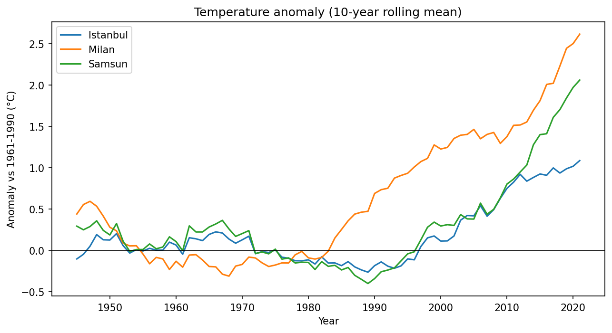
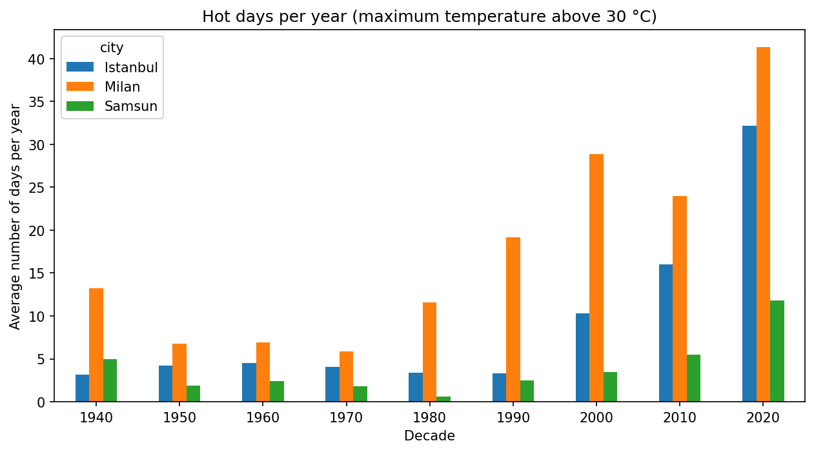

# Weather Report

Is the climate really changing where we live? This project downloads daily
weather data from 1940 to 2025 for three cities (Samsun, Milan and Istanbul)
and studies how temperatures have changed over time.

Project for the Python module of the *Coding for Data Science and Data
Management* course (A.Y. 2026/27).

## What the project does

- downloads daily temperature and precipitation data from the Open-Meteo API
- cleans the data and computes yearly summaries with pandas
- computes temperature anomalies (compared with 1961-1990) and the warming
  trend per decade with numpy
- plots the anomalies and monthly temperature heatmaps with matplotlib
- presents the results in a Jupyter notebook

## Data source

[Open-Meteo Historical Weather API](https://open-meteo.com/en/docs/historical-weather-api)
(free, no registration). The data is model-based reanalysis data, not direct
station measurements. The CSV files are not stored in this repository: they
are downloaded by a script (see below).

## Project structure

```
python-project/
├── src/
│   ├── data_loader.py       # downloads the data and saves it as CSV
│   ├── data_processing.py   # loads, cleans and summarises the data
│   ├── analysis.py          # anomalies and temperature trend (numpy)
│   └── plots.py             # plotting functions (matplotlib)
├── figures/                 # saved plots
├── weather_report.ipynb     # presentation notebook
├── requirements.txt         # Python libraries
└── README.md
```

## How to run

1. Clone the repository and enter the folder:
   ```
   git clone https://github.com/sudebayram-hue/python-project.git
   cd python-project
   ```
2. Install the libraries (Python 3.14 was used):
   ```
   pip install -r requirements.txt
   ```
3. Download the data into the `data/` folder:
   ```
   python src/data_loader.py
   ```
   If the server answers "429 Too Many Requests", wait a few minutes and run
   the command again: cities that were already downloaded are skipped.
4. Open `weather_report.ipynb` (for example in VS Code) and run all the cells.

## Main results

| City     | Warming trend 1940-2025 |
|----------|-------------------------|
| Milan    | +0.31 °C per decade     |
| Samsun   | +0.17 °C per decade     |
| Istanbul | +0.13 °C per decade     |

Temperatures were stable until about 1990 and then increased quickly in all
three cities.



Hot days (maximum temperature above 30 °C) became much more frequent: in 2011-2025 Milan has about 31 hot days per year, against about 8 in 1961-1990.



## Libraries

pandas, numpy, matplotlib, requests (see `requirements.txt` for versions). 